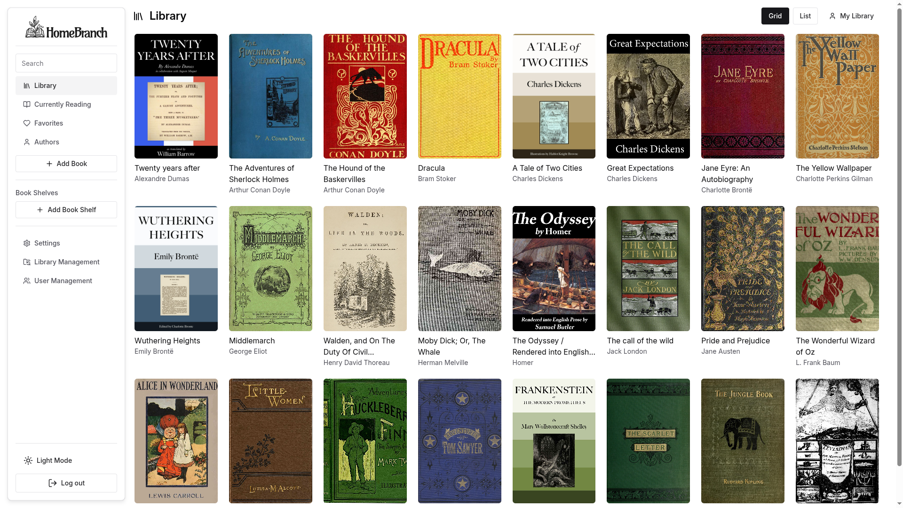
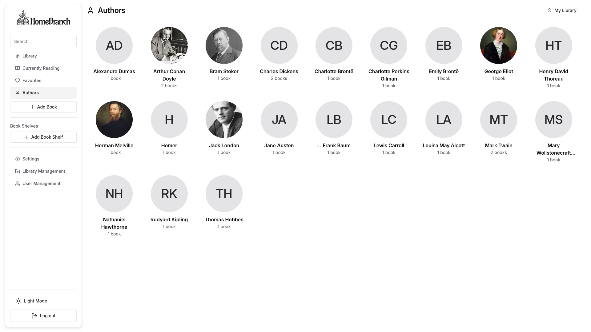

<picture>
  <source media="(prefers-color-scheme: dark)" srcset="images/Logo%202-Color%20For%20Dark.svg">
  
</picture>

Homebranch is a self-hosted web application for managing and reading your ebook collection. It provides a user-friendly interface to organize, search, and read ebooks across devices.

> [!NOTE]
> This repository is the Homebranch project workspace. It includes the component repositories as submodules and provides the integrated development environment:
> - [Homebranch API](https://github.com/Oghamark/homebranch-api): NestJS backend API built with TypeScript
> - [Homebranch Web](https://github.com/Oghamark/homebranch-web): React frontend built with TypeScript
> - [Authentication](https://github.com/Oghamark/Authentication): standalone NestJS authentication service

---

## Preview

<picture>
  <source media="(prefers-color-scheme: dark)" srcset="images/library_view.png">
  
</picture>
<picture>
  <source media="(prefers-color-scheme: dark)" srcset="images/book_details_view.png">
  
</picture>
<picture>
  <source media="(prefers-color-scheme: dark)" srcset="images/authors_view.png">
  
</picture>

---

## Features

- Ebook, PDF, MP3, and M4B management with in-browser reading and audiobook playback
- Linked formats, book shelves, favorites, and reading-position synchronization
- Metadata enrichment from Open Library and optional Google Books integration
- User management, role-based access, and OIDC single sign-on
- OPDS v1.2 and v2.0 catalogs for compatible e-readers
- Automated library scanning, soft deletion, bidirectional EPUB metadata sync, and duplicate detection
- Background processing through BullMQ and Redis
- Real-time library updates through Server-Sent Events
- Installable progressive web app with dark and light themes

---

## Installation

See the [Homebranch documentation](https://homebranch.app/docs/getting-started/) for production installation and configuration.

## Local development

Clone the project with all component submodules:

```sh
git clone --recurse-submodules https://github.com/Oghamark/homebranch.git
cd homebranch
```

For an existing clone, initialize the component repositories:

```sh
git submodule update --init --recursive
```

Copy `.env.example` to `.env`, assign non-empty values to its variables, and start the development environment:

```sh
cp .env.example .env
docker compose -f docker-compose.dev.yml up
```

The development stack reloads source changes automatically. The web application runs at http://localhost:5173, the API at http://localhost:8080, and authentication at http://localhost:3000.

Use `docker compose -f docker-compose.dev.yml down` to stop the stack. Add `-v` to remove the development database, Redis, uploads, and dependency volumes.

## OPDS

Homebranch exposes an OPDS catalog for e-readers such as KOReader and Thorium.

| Feed | URL |
| --- | --- |
| OPDS 1.2 catalog root | `/opds/v1/catalog` |
| OPDS 2.0 catalog root | `/opds/v2/catalog` |
| Authentication document | `/opds/v1/auth` |

Authentication uses HTTP Basic Auth and the companion Authentication service. See the [API repository](https://github.com/Oghamark/homebranch-api) for endpoint behavior and configuration details.

## Contributing

Contributions are welcome. Read the [contribution guidelines](CONTRIBUTING.md) for the project workflow, development setup, and pull request expectations.

---

## License

Homebranch is licensed under the [GNU Affero General Public License v3.0](LICENSE).

## Credits

- HomeBranch logo and iconography © 2026 [Acro Visuals, L.L.C.](https://acrovisuals.com) are licensed under [CC BY-SA 4.0](https://creativecommons.org/licenses/by-sa/4.0/).
